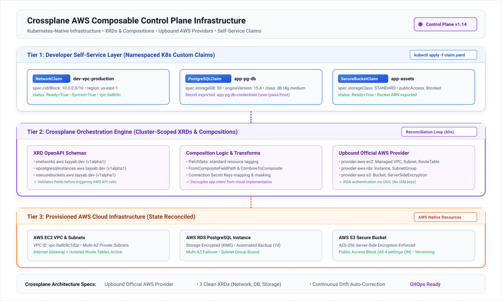

# 🏗️ Crossplane AWS Composable Control Plane Infrastructure

<div align="center">

[]()
[]()
[](https://crossplane.io)
[](https://marketplace.upbound.io/providers/upbound/provider-aws)
[](LICENSE)
[]()

**Engineered by [Tayyab Masood](https://github.com/tayyabmasood911)**  
*Cloud Solutions Architect & DevOps Platform Engineer*

</div>

---

## 📋 Executive Overview

**crossplane-aws-composable-infrastructure** transforms Kubernetes into a self-service, enterprise-grade cloud control plane for AWS. Utilizing open-source **Crossplane (`>= v1.14.0`)** and the **Upbound Official AWS Provider (`provider-aws`)**, this repository provides declarative **CompositeResourceDefinitions (XRDs)** and **Compositions** that allow software development teams to request hardened, compliant cloud resources (VPCs, RDS PostgreSQL databases, and secure S3 storage) via standard Kubernetes Custom Resources (Claims) without learning complex cloud vendor APIs or managing static credentials.

### Key Architectural Tenets
- **Separation of Concerns:** Platform architects define organizational standards, tags, encryption, and network topology in cluster-scoped Compositions; product developers request infrastructure using simple, abstracted namespace-scoped Claims.
- **Continuous Drift Correction:** Unlike traditional CLI-based IaC which only runs during pipeline triggers, Crossplane actively watches real AWS resource state and automatically heals configuration drift back to the declared git state.
- **Native Kubernetes RBAC & Secrets Delivery:** Infrastructure status is reported via `kubectl`, and connection details (database host, username, password) are published directly into the developer's Kubernetes namespace as standard Secret resources.
- **Zero Static AWS Credentials:** Upbound AWS providers authenticate via IAM Roles for Service Accounts (IRSA) with temporary STS credentials.

---

## 🏛️ Architecture Blueprint

The diagram below details the 3-tier hierarchy: Namespaced Developer Claims -> Crossplane XRD & Composition Engine -> AWS Provisioned Cloud Infrastructure:



---

## 🚀 Key Features

| Composable API | Upbound Resource Mapping | Enterprise Hardening Applied |
| :--- | :--- | :--- |
| **`NetworkClaim`** (`XNetwork`) | AWS VPC, Subnets, InternetGateway, RouteTables | Dedicated CIDR validation, automated DNS hostnames, standard tagging |
| **`PostgreSQLClaim`** (`XPostgreSQLInstance`) | AWS RDS DBInstance & DBSubnetGroup | KMS storage encryption enforced, multi-AZ support, automatic 7-day backup |
| **`SecureBucketClaim`** (`XSecureBucket`) | AWS S3 Bucket, BucketPublicAccessBlock | All 4 public access blocks strictly enabled, AES-256 encryption default |

---

## 📂 Repository Structure

```tree
crossplane-aws-composable-infrastructure/
├── .github/
│   └── workflows/
│       └── ci.yml                 # Crossplane schema linting and automated test pipeline
├── apis/
│   ├── network/
│   │   ├── definition.yaml        # XRD: CompositeNetwork (VPC & Subnet schema)
│   │   └── composition.yaml       # Composition: Upbound AWS EC2 resources
│   ├── database/
│   │   ├── definition.yaml        # XRD: CompositePostgreSQLInstance schema
│   │   └── composition.yaml       # Composition: Hardened AWS RDS PostgreSQL
│   └── storage/
│       ├── definition.yaml        # XRD: CompositeSecureBucket schema
│       └── composition.yaml       # Composition: S3 Bucket with public access blocks
├── config/
│   └── production.env.example     # Environment template
├── docs/
│   └── architecture.svg           # High-clarity vector architecture visual (White theme)
├── examples/
│   └── claims/
│       ├── network-claim.yaml     # Sample developer NetworkClaim
│       ├── database-claim.yaml    # Sample developer PostgreSQLClaim
│       └── storage-claim.yaml     # Sample developer SecureBucketClaim
├── scripts/
│   └── healthcheck.sh             # Runtime cluster health verification script
├── tests/
│   └── test_validation.py         # Automated pytest test validation suite
├── .gitattributes                 # Linguist overrides and line ending standardization
├── LICENSE                        # MIT License
├── Makefile                       # Developer lifecycle command targets
├── crossplane.yaml                # Crossplane Package metadata (Configuration)
├── definition.yaml                # Root composite definition entrypoint
├── composition.yaml               # Root composition pipeline entrypoint
└── README.md                      # Comprehensive production documentation
```

---

## ⚡ Quick Start Guide

### Prerequisites
- A Kubernetes cluster (`>= 1.27`) with Crossplane installed:
  ```bash
  helm repo add crossplane-stable https://charts.crossplane.io/stable
  helm install crossplane crossplane-stable/crossplane --namespace crossplane-system --create-namespace
  ```
- Upbound AWS Providers installed:
  ```bash
  kubectl apply -f - <<EOF
  apiVersion: pkg.crossplane.io/v1
  kind: Provider
  metadata:
    name: provider-aws-ec2
  spec:
    package: xpkg.upbound.io/upbound/provider-aws-ec2:v1.1.0
  ---
  apiVersion: pkg.crossplane.io/v1
  kind: Provider
  metadata:
    name: provider-aws-rds
  spec:
    package: xpkg.upbound.io/upbound/provider-aws-rds:v1.1.0
  ---
  apiVersion: pkg.crossplane.io/v1
  kind: Provider
  metadata:
    name: provider-aws-s3
  spec:
    package: xpkg.upbound.io/upbound/provider-aws-s3:v1.1.0
  EOF
  ```

### Step 1: Clone Repository
```bash
git clone https://github.com/tayyabmasood911/crossplane-aws-composable-infrastructure.git
cd crossplane-aws-composable-infrastructure
```

### Step 2: Install Compositions & Definitions
```bash
kubectl apply -f apis/network/definition.yaml
kubectl apply -f apis/network/composition.yaml
kubectl apply -f apis/database/definition.yaml
kubectl apply -f apis/database/composition.yaml
kubectl apply -f apis/storage/definition.yaml
kubectl apply -f apis/storage/composition.yaml
```

### Step 3: Deploy Developer Infrastructure Claims
```bash
kubectl apply -f examples/claims/network-claim.yaml
kubectl apply -f examples/claims/database-claim.yaml
kubectl apply -f examples/claims/storage-claim.yaml
```

### Step 4: Monitor Provisioning Status
```bash
kubectl get claims -A
kubectl get managed
```

Upon reconciliation, the database credentials appear in the developer's namespace:
```bash
kubectl get secret production-pg-database-credentials -o yaml
```

---

## 🧪 Verification & Automated Testing

Execute the automated test suite via `make` or `pytest`:

```bash
# Run automated validation test suite
make test

# Or run pytest directly
pytest tests/test_validation.py -v
```

### Healthcheck Script
Run the automated runtime health check:
```bash
bash scripts/healthcheck.sh
```

---

## 🔒 Security & Policy Guardrails

1. **Least-Privilege IRSA:** Upbound provider pods use OpenID Connect (OIDC) Web Identity federation to assume scoped IAM roles with zero hardcoded keys.
2. **Mandatory Storage Encryption:** Compositions enforce KMS storage encryption on databases and `AES-256` encryption on S3 buckets; unencrypted resources are rejected at synthesis time.
3. **Public Access Prevention:** S3 Compositions enforce `BlockPublicAcls`, `BlockPublicPolicy`, `IgnorePublicAcls`, and `RestrictPublicBuckets`.
4. **Vulnerability Reporting:** See [SECURITY.md](SECURITY.md) for responsible disclosure procedures.

---

## 👤 Author & Maintainer

**Tayyab Masood**
- GitHub: [@tayyabmasood911](https://github.com/tayyabmasood911)
- LinkedIn: [Tayyab Masood](https://www.linkedin.com/in/tayyabmasood911)
- Portfolio Showcase: [cloud-devops-portfolio](https://github.com/tayyabmasood911/cloud-devops-portfolio)

---

## 📄 License

This project is licensed under the MIT License - see the [LICENSE](LICENSE) file for details.
